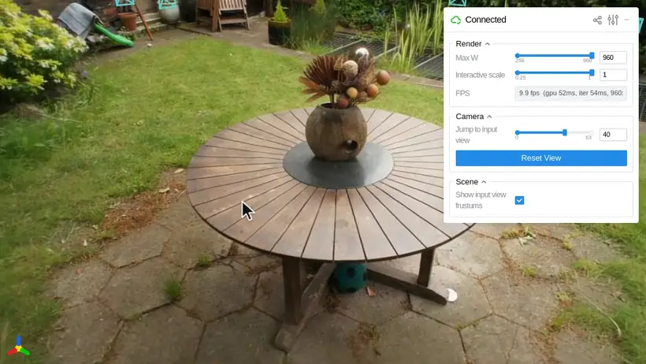

<h1 align="center">Decoder-only View Synthesis Model</h1>

<h3 align="center">
  <a href="https://arxiv.org/abs/2605.29891">DVSM</a> (arXiv 2026) | <a href="https://test-time-baking.github.io/">TTB</a> (NeurIPS 2026 Spotlight) | <a href="https://huggingface.co/nvidia/DVSM">🤗 HuggingFace</a> | <a href="https://huggingface.co/spaces/nvidia/DVSM">Online Demo</a>
</h3>

<p align="center">
  
</p>

DVSM is an end-to-end novel-view synthesis model that reconstructs scenes as latent states and renders views with a single Transformer network. Our model already matches or outperforms per-scene-optimized 3DGS, even under very dense input views.

## News

- **2026-11**: TTB (Test-Time Baking) code and checkpoints released.
- **2026-09**: TTB is accepted to NeurIPS 2026 as a Spotlight. 🎉
- **2026-05**: DVSM paper released on arXiv.

## Table of Contents

- [Get Started](#get-started)
- [Interactive Demo](#interactive-demo)
- [Checkpoints](#checkpoints)
- [Custom Dataset Preparation](docs/data.md)
- [Training](docs/train.md)
- [Evaluation](docs/eval.md)
- [Citation](#citation)

## Get Started

### Installation

```bash
git clone https://github.com/NVlabs/DVSM.git
cd DVSM
pip install -r requirements.txt
```

### Inference

A checkpoint directory is either a Hugging Face download (`config.json` + `model.safetensors`, see [Checkpoints](#checkpoints)) or a `train.py` output (`config.yaml` + `latest.pt`). Both are loaded the same way.

```python
import torch
from dvsm.config import cfg, update_config_from_ckpt
from dvsm.models.DVSM import DecoderViewSynthesisModel, load_checkpoint

device = "cuda"

# Load checkpoint — the config file sets the architecture, the weight file the parameters.
ckpt_root = "outputs/DVSM-TTB-p8-DL3DV-960p"
update_config_from_ckpt(ckpt_root)
model = DecoderViewSynthesisModel(**cfg.model).to(device).eval()
load_checkpoint(model, ckpt_root)

# Context (input) views — the model is pose-conditioned:
#   image : [B, V, 3, H, W]  float in [0, 1]; H and W must be multiples of the patch size (see Checkpoints)
#   intr  : [B, V, 4]        normalized (fx / W, fy / H, cx / W, cy / H), focal lengths and principal point in pixels
#   c2w_r : [B, V, 3, 3]     camera-to-world rotation
#   c2w_t : [B, V, 3]        camera-to-world translation
# Cameras follow the OpenCV convention (+X right, +Y down, +Z forward). For OpenGL / nerfstudio
# poses, negate the 2nd and 3rd columns of c2w_r first. The world origin, orientation and scale are
# arbitrary (poses are normalized internally), but at least two views with distinct camera centers are needed.
image, intr, c2w_r, c2w_t = ...  # your V input views

# Target cameras, in the same world frame as the input views:
#   tgt_intr : [B, T, 4], tgt_c2w_r : [B, T, 3, 3], tgt_c2w_t : [B, T, 3]
tgt_intr, tgt_c2w_r, tgt_c2w_t = ...  # your T novel views

with torch.no_grad():
    # Reconstruct the scene -> returns a renderer that caches the scene representation
    # (baked fast-weight MLP for TTB models, or KV-cache for DVSM base).
    renderer = model(image.to(device), intr.to(device), c2w_r.to(device), c2w_t.to(device))

    # Render novel views from arbitrary target cameras -> [B, T, 3, H, W] in [0, 1].
    # The output H and W must be multiples of the patch size as well. The result is in the
    # mixed-precision dtype (bfloat16): call rgb.float() before converting it to NumPy.
    rgb = renderer(tgt_intr.to(device), tgt_c2w_r.to(device), tgt_c2w_t.to(device), H=544, W=960)
```

## Interactive Demo

The demo runs in two stages: **reconstruct** a scene into a self-contained `.recon.pt` artifact (baked fast weights + pose state — no input images needed afterwards), then **serve** it in a browser viewer for real-time novel-view synthesis at arbitrary camera poses.

### Install

```bash
pip install -r requirements_demo.txt
```

### Stage 1 — Reconstruct a scene

`viser_app/recon_scene.py` bakes a scene from images or a video into a `.recon.pt` file.

**Supported inputs** (`--input`):

<details>
<summary>Input structure reference</summary>

COLMAP scene (`--pose colmap`):
```
scene/
├── sparse/0/
│   ├── cameras.bin
│   ├── images.bin
│   └── points3D.bin
└── images/
    ├── frame_001.jpg
    └── ...
```

Nerfstudio / `transforms.json` scene (`--pose colmap`):
```
scene/
├── transforms.json
└── images/
    ├── frame_001.jpg
    └── ...
```

Flat image folder or video (`--pose pi3`, poses estimated automatically with **π³**):
```
my_scene/          my_clip.mp4
├── 00.jpg
├── 01.jpg
└── ...
```

</details>

**Pose options** (`--pose`):
- `auto` (default) — `colmap` if the input contains COLMAP `sparse/` or `transforms.json`, otherwise `pi3`
- `colmap` — reads poses from COLMAP `sparse/` or `transforms.json`. Lens distortion is ignored for both formats (COLMAP distortion parameters and the `k1` / `k2` / `p1` / `p2` entries of `transforms.json` are not applied; every camera is treated as a pinhole), so undistort the images first if the distortion is not negligible.
- `pi3` — estimates poses automatically with **π³** (no camera calibration needed)

```bash
# COLMAP / transforms.json scene
python -m viser_app.recon_scene \
    --ckpt_root outputs/DVSM-TTB-p8-DL3DV-960p \
    --input /path/to/scene --pose colmap \
    --max_views 32 --out outputs/recon/scene.recon.pt

# Image folder or video — poses estimated with π³
python -m viser_app.recon_scene \
    --ckpt_root outputs/DVSM-TTB-p8-DL3DV-960p \
    --input my_clip.mp4 --pose pi3 \
    --max_views 32 --out outputs/recon/clip.recon.pt
```

Key flags:
| Flag | Default | Description |
|---|---|---|
| `--max_views` | all views | Maximum number of context views to bake, sub-sampled evenly. When not set, every image is used; a video is decoded to 64 frames. |
| `--long_edge` | 960 | Resize long edge to this resolution before baking |
| `--out` | required | Output path for the `.recon.pt` artifact |

### Stage 2 — Launch the viewer

> **See [`viser_app/viewer.py`](viser_app/viewer.py) for the full list of options.**

`viser_app/viewer.py` loads a `.recon.pt` and serves a real-time novel-view synthesis viewer in your browser, powered by [viser](https://github.com/nerfstudio-project/viser). No display server required — the viewer runs headlessly and streams to any browser.

```bash
python -m viser_app.viewer \
    --ckpt_root outputs/DVSM-TTB-p8-DL3DV-960p \
    --recon outputs/recon/scene.recon.pt \
    --port 8080    # open http://localhost:8080 in your browser
```

`--share` prints a public `*.share.viser.studio` URL accessible from anywhere without a tunnel.

**Controls** (in the browser):
- **Left drag** — orbit / rotate camera
- **Right drag** — pan
- **Scroll** — zoom in / out

**Running on a remote GPU node?** Forward the port over SSH and open it locally:

```bash
# On your local machine
ssh -L 8080:localhost:8080 <gpu-server>
# Then open http://localhost:8080 in your browser
```

### Gradio demo (end-to-end)

Upload images or a video → π³ pose estimation → TTB-DVSM reconstruction → embedded browser viewer, all in one web UI:

```bash
python -m viser_app.gradio_demo                                           # default checkpoint
python -m viser_app.gradio_demo --ckpt_root outputs/DVSM-TTB-p8-DL3DV-960p  # explicit checkpoint
python -m viser_app.gradio_demo --port 7860 --share                       # public URL
```

## Checkpoints

Pretrained checkpoints are hosted on Hugging Face in a single repository, [nvidia/DVSM](https://huggingface.co/nvidia/DVSM), with one sub-folder per model. Download and place each checkpoint folder under `outputs/`.

| Model | HuggingFace (sub-folder of `nvidia/DVSM`) | Training data | Resolution | Patch size | Backbone |
|---|---|---|---|---|---|
| DVSM | [DVSM-p8-DL3DV-480p](https://huggingface.co/nvidia/DVSM/tree/main/DVSM-p8-DL3DV-480p) | DL3DV | 480p | 8 | — |
| DVSM | [DVSM-p8-DL3DV-720p](https://huggingface.co/nvidia/DVSM/tree/main/DVSM-p8-DL3DV-720p) | DL3DV | 720p | 8 | — |
| DVSM | [DVSM-p8-DL3DV-960p](https://huggingface.co/nvidia/DVSM/tree/main/DVSM-p8-DL3DV-960p) | DL3DV | 960p | 8 | — |
| DVSM | [DVSM-p16-DINO-DL3DV-480p](https://huggingface.co/nvidia/DVSM/tree/main/DVSM-p16-DINO-DL3DV-480p) | DL3DV | 480p | 16 | DINO |
| DVSM | [DVSM-p16-DINO-DL3DV-720p](https://huggingface.co/nvidia/DVSM/tree/main/DVSM-p16-DINO-DL3DV-720p) | DL3DV | 720p | 16 | DINO |
| DVSM | [DVSM-p16-DINO-DL3DV-960p](https://huggingface.co/nvidia/DVSM/tree/main/DVSM-p16-DINO-DL3DV-960p) | DL3DV | 960p | 16 | DINO |
| TTB-DVSM | [DVSM-TTB-p8-DL3DV-960p](https://huggingface.co/nvidia/DVSM/tree/main/DVSM-TTB-p8-DL3DV-960p) | DL3DV | 960p | 8 | — |
| TTB-DVSM | [DVSM-TTB-p16-DINO-DL3DV-960p](https://huggingface.co/nvidia/DVSM/tree/main/DVSM-TTB-p16-DINO-DL3DV-960p) | DL3DV | 960p | 16 | DINO |
| TTB-DVSM-minus | [DVSM-TTB-Minus-p8-DL3DV-960p](https://huggingface.co/nvidia/DVSM/tree/main/DVSM-TTB-Minus-p8-DL3DV-960p) | DL3DV | 960p | 8 | — |
| DVSM | [DVSM-p8-DINO-RE10K-512p](https://huggingface.co/nvidia/DVSM/tree/main/DVSM-p8-DINO-RE10K-512p) | RealEstate10K | 512p | 8† | DINO |
| TTB-DVSM | [DVSM-TTB-p8-DINO-RE10K-512p](https://huggingface.co/nvidia/DVSM/tree/main/DVSM-TTB-p8-DINO-RE10K-512p) | RealEstate10K | 512p | 8† | DINO |
| TTB-DVSM-minus | [DVSM-TTB-Minus-p8-DINO-RE10K-512p](https://huggingface.co/nvidia/DVSM/tree/main/DVSM-TTB-Minus-p8-DINO-RE10K-512p) | RealEstate10K | 512p | 8† | DINO |

† A 16×16 patchifier applied to 2× up-sampled images (`recon_up_scale = render_up_scale = 2`), i.e. an effective patch size of 8.

**TTB-DVSM** renders novel views in O(1) — no KV-cache at render time. Cross-view attention runs only during reconstruction to supervise the baked fast-weight MLP. **TTB-DVSM-minus** drops cross-view attention entirely for the fastest reconstruction, at a small quality cost. **DVSM** retains the full KV-cache and serves as the baseline.

To download a checkpoint:

```bash
hf download nvidia/DVSM --include "DVSM-TTB-p8-DL3DV-960p/*" --local-dir outputs
```

This places the checkpoint in `outputs/DVSM-TTB-p8-DL3DV-960p/`.

### DINO backbone

Models with a DINO backbone build the [DINOv3 ViT-L/16](https://huggingface.co/facebook/dinov3-vitl16-pretrain-lvd1689m) network through `transformers` and read it from the local Hugging Face cache without contacting the Hub. That repository is gated, so download it once before the first use: request access on its model page (this requires accepting the DINOv3 license) and wait until the request has been approved, log in with `hf auth login`, then run

```bash
python -c "from transformers import AutoModel; AutoModel.from_pretrained('facebook/dinov3-vitl16-pretrain-lvd1689m')"
```

This applies to loading a released DINO checkpoint as well as to training or benchmarking with `--model.backbone dino`.

## Training

To bring your own posed-image dataset into DVSM's HDF5 format, see [docs/data.md](docs/data.md).

Please refer to [docs/train.md](docs/train.md) for dataset preparation and training commands (DL3DV, RealEstate10K, ablations, multi-node setup).

## Evaluation

Please refer to [docs/eval.md](docs/eval.md) for benchmark evaluation, zero-shot generalization, local-duplicate fast weights, and runtime benchmarks.

## Citation

If you find this work useful, please cite:

```bibtex
@article{sun2026dvsm,
  title   = {DVSM: Decoder-only View Synthesis Model Done Right},
  author  = {Sun, Cheng and Choe, Jaesung and Chen, Min-Hung and Hachiuma, Ryo and Wang, Yu-Chiang Frank},
  journal = {arXiv preprint arXiv:2605.29891},
  year    = {2026}
}
```

```bibtex
@article{lin2026ttb,
  title   = {TTB: Test-time MLP Baking for Efficient Rendering of Decoder-only View Synthesis Models},
  author  = {Lin, Chin-Yang and Hachiuma, Ryo and Choe, Jaesung and Chen, Min-Hung and Wang, Yu-Chiang Frank and Lin, Yen-Yu and Chiu, Wei-Chen and Liu, Yu-Lun and Sun, Cheng},
  journal = {arXiv preprint arXiv:2611.17331},
  year    = {2026}
}
```

